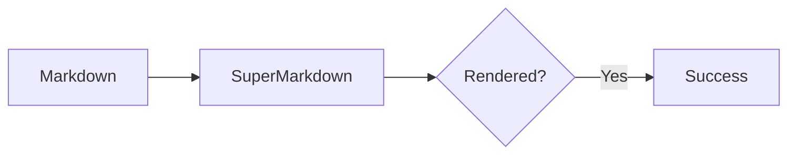

# SuperMarkdown Smoke Test

Use this file for the manual checklist. Changes are disposable.

## Basic GFM

| Feature     | Result                |
| ----------- | --------------------- |
| Table       | Rendered              |
| Scroll sync | Check both directions |

- [ ] Click this task checkbox
  - [x] Nested completed task
1. [ ] Numbered task

> [!NOTE]
> GitHub-style alert rendering.

Emoji shortcode: :rocket:

Footnote reference.[^1]

[^1]: Footnote text.

Inline math: $E = mc^2$

$$
x = y + 1
$$

## Syntax highlighting

```ts
const answer: number = 42;
console.log(answer);
```

## Valid Mermaid



## Invalid Mermaid

```mermaid
flowchart LR
  A -->
```

## Editing and comments

This standalone paragraph can be edited from the preview. Select the words **standalone paragraph** to add a review comment.

## Links and images

- [Jump to editing](#editing-and-comments)
- [Open linked Markdown](linked.md#linked-heading)
- Local image: 
- Missing image: 

## Scroll target

Scroll here from the source editor, then scroll the preview back to the top to verify both directions.
